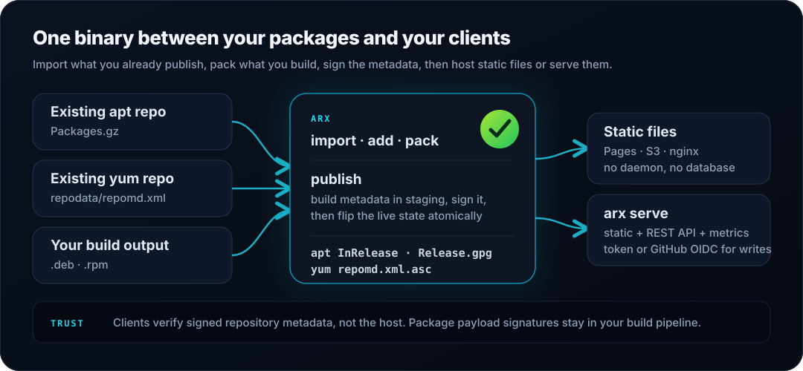

<p align="center">
  <picture>
    <source media="(prefers-color-scheme: dark)" srcset="res/logo-dark.svg">
    
  </picture>
</p>

<p align="center">
  <a href="https://github.com/artifactx-rs/artifactx/actions/workflows/ci.yml"></a>
  <a href="https://github.com/artifactx-rs/artifactx/actions/workflows/release.yml"></a>
  <a href="https://github.com/artifactx-rs/artifactx/releases/latest"></a>
  <a href="https://crates.io/crates/artifactx"></a>
</p>

<h3 align="center">Import first. Cut over when ready.</h3>

<p align="center">
  Pull packages from the repositories you already publish, build new ones when you need them,
  re-sign apt/yum metadata under your own key, and serve the result from one static Rust binary.
</p>

---

ArtifactX (`arx`) is for teams that ship Linux packages and are tired of operating
Nexus, aptly, Pulp, S3 glue scripts, a custom signing job, and a web server just so
users can run `apt install` or `dnf install`.

The repository is a directory you can inspect, back up, move, and rebuild. The
service is one binary with no daemon state and no database.

## Five minutes to a signed repo

```bash
arx init ./repo                        # repository layout + signing key
arx add dist --root ./repo             # your built .deb / .rpm files
arx publish --root ./repo              # sign and index apt + yum metadata
arx serve --root ./repo                # http://127.0.0.1:8080
```

Then point a client at it — trust the repo key, and the distro does the rest:

```bash
# apt
sudo install -d -m 0755 /etc/apt/keyrings
curl -fsSL http://REPO_HOST:8080/keys/public.asc \
  | sudo tee /etc/apt/keyrings/arx.asc >/dev/null

echo 'deb [signed-by=/etc/apt/keyrings/arx.asc] http://REPO_HOST:8080/apt stable main' \
  | sudo tee /etc/apt/sources.list.d/arx.list >/dev/null

sudo apt-get update && sudo apt-get install myapp
```

```bash
# dnf / yum
sudo tee /etc/yum.repos.d/arx.repo >/dev/null <<'EOF_REPO'
[arx]
name=ArtifactX
baseurl=http://REPO_HOST:8080/yum/myrepo/x86_64
enabled=1
gpgcheck=0
repo_gpgcheck=1
gpgkey=http://REPO_HOST:8080/keys/public.asc
EOF_REPO

sudo dnf install myapp
```

`arx serve` binds `127.0.0.1` only, so `REPO_HOST` is `127.0.0.1` for a same-host
trial. Serving other machines means `--addr 0.0.0.0:8080` for a LAN-only run, or a
TLS terminator in front — see [Install clients](docs/how-to/install-clients.md).

No upstream repository yet? Start from an existing one instead:

```bash
arx import https://packages.example.com --apt \
  --dist stable --component main --match-name myapp --limit 20 --root ./repo
```

## How it works

<p align="center">
  
</p>

Three things enter, one thing leaves:

- **Import** reads apt `Packages.gz` / `Packages` or yum `repodata/repomd.xml` and copies
  matching package payloads into the local pool.
- **Add** takes `.deb` / `.rpm` files or directories containing them.
- **Pack** builds `.deb`, `.rpm`, `.apk`, and Arch `.pkg.tar.zst` from an ArtifactX
  manifest or a Rust `Cargo.toml`. It packages binaries you have already built —
  it does not run `cargo build` for you. Only `.deb` and `.rpm` feed the apt/yum
  index; the other two are artifacts for downstream channels.

`publish` then regenerates apt and yum metadata, signs it, and flips the live state
atomically. Clients verify the signature, not the host — so the same output works from
GitHub Pages, S3, nginx, or `arx serve`.

## Pick your entry point

| What you have | Command | Why |
| --- | --- | --- |
| An apt repo you already publish | `arx import --apt` | Migrate a slice, verify clients, cut over |
| A yum/dnf repo | `arx import --yum` | Same, for `repodata` |
| `.deb` / `.rpm` files on disk | `arx add` | Index what your build already produced |
| A Cargo crate or package manifest | `arx pack` | Produce all four package formats |
| A CI drop directory | `arx publish-dir` | Discovery, no-op detection, publish, cutover |

Imports are bounded on purpose: `--match-name`, `--arch`, and `--limit` keep the first
migration small enough to verify before it matters.

### What import does not do

- It does **not** reuse upstream repository signatures. `InRelease`, `Release.gpg`, and
  `repomd.xml.asc` are regenerated for *your* repository metadata.
- It is **not** a bit-for-bit mirror. Use a mirror when you need continuous upstream sync.
- It **does not** re-sign packages by default. Payload signatures are preserved as-is;
  yum imports can opt into `--resign-rpms`, which uses the system `rpmsign --resign`
  identity after upstream size/checksum checks.

## Signing model

ArtifactX signs repository metadata, not individual packages:

| Ecosystem | What clients verify |
| --- | --- |
| apt | `InRelease` / `Release.gpg` |
| yum / dnf | `repomd.xml.asc` |

Three supported paths:

```bash
# 1. Local/dev — let arx generate the key (warns if unencrypted)
arx init ./repo && arx publish --root ./repo

# 2. Production — encrypt the generated key
arx init ./repo --passphrase-file passphrase.txt
arx publish --root ./repo --passphrase-file passphrase.txt

# 3. Company key — import the armored private key you already control
arx init ./repo --no-key
arx key import company-private.asc --root ./repo --passphrase-file passphrase.txt
```

CI can pass the passphrase as `ARX_KEY_PASSPHRASE` instead of a file. Rotating a key
requires a client trust rollout before the next cutover:

```bash
arx key rotate --root ./repo --passphrase-file passphrase.txt
arx key export --root ./repo > public.asc
```

Not configurable yet, deliberately: key algorithm, RSA size, signature policy. A
compatible RSA/OpenPGP profile beats exposing crypto knobs on the happy path.

### Expiry

New apt repositories get `valid_days = 7`, so every `publish` writes a signed
`Valid-Until` and republishing refreshes the window. Set it to `0` to omit the field:

```toml
[apt]
valid_days = 7
```

Everything else — key expiry, HSM/KMS, audit trails, rotation policy — is your
operator policy, not something ArtifactX should guess.

## Install arx

| Method | Command |
| --- | --- |
| Cargo | `cargo install artifactx` |
| Static binary | `curl -fsSLO https://github.com/artifactx-rs/artifactx/releases/latest/download/arx-latest-amd64` then `sudo install -m 755 arx-latest-amd64 /usr/local/bin/arx` |
| Nix | `nix run github:artifactx-rs/artifactx -- --version` |
| Docker | `docker run --rm -v $(pwd)/repo:/repo -p 8080:8080 ghcr.io/artifactx-rs/arx:latest serve --root /repo --addr 0.0.0.0:8080` |
| Docker Compose | `arx compose --root ./repo --out ./deploy && cd ./deploy && docker compose up -d` |
| From source | `cargo build --release` |

`arx serve` binds `127.0.0.1:8080` by default. That is intentional — put Caddy, nginx, or
another TLS terminator in front when you expose a repo publicly. Only the generated
Compose file binds `0.0.0.0`, because Docker port publishing needs a non-localhost
listener inside the container.

## Commands

| Command | Why you use it |
| --- | --- |
| `arx init` | Create repository layout, config, and signing key |
| `arx import` | Migrate packages from an existing apt/yum repo |
| `arx pack` | Build `.deb`, `.rpm`, `.apk`, `.pkg.tar.zst` from a manifest or `Cargo.toml` |
| `arx add` | Put existing `.deb` / `.rpm` files, or directories containing them, into the pool |
| `arx publish` | Generate and sign apt + yum metadata; optionally cut over live public symlinks |
| `arx serve` | Serve an apt/dnf-compatible repo + REST API + `/metrics` |
| `arx push` | Upload packages to a remote `arx serve` from CI |
| `arx promote` | Move packages between staging/prod components or repos |
| `arx rm` | Yank a package from the pool |
| `arx gc` | Prune old versions with version-aware retention |
| `arx rollback` | Restore a previous published state |
| `arx history` | Inspect retained published states |
| `arx publish-dir` | Ingest a drop directory, publish, cut over, optionally sync downstream |
| `arx watch` | Watch a directory and auto-add + publish new packages |
| `arx key` | Generate, import, rotate, revoke, or export signing keys |

## Operate it

| Task | Guide |
| --- | --- |
| systemd service on a single host | [Run as a systemd service](docs/how-to/run-as-systemd-service.md) |
| Docker Compose deployment | [Run with Docker Compose](docs/how-to/run-with-docker-compose.md) |
| Public serverless repo | [Publish with GitHub Pages](docs/how-to/publish-with-github-pages.md) |
| CI uploads to a live server | [Push packages from CI](docs/how-to/push-from-ci.md) |
| TLS and reverse proxy | [Secure `arx serve` behind a proxy](docs/how-to/secure-serve-behind-proxy.md) |
| Backup, restore, rollback | [Operations guide](docs/OPERATIONS.md) |
| Client setup (apt, dnf) | [Install clients](docs/how-to/install-clients.md) |

Reads are public; writes need `ARX_SERVE_TOKEN` or configured GitHub Actions OIDC.
Running servers expose OpenAPI at `/api/openapi.yaml` and Swagger UI at `/api/docs`.

## Repository layout

```text
repo/
  arx.toml
  keys/private.asc, public.asc
  apt/pool/<component>/
  apt/dists/<dist>/
  yum/<repo>/<arch>/repodata/
```

Back it up with `tar`. Restore by extracting. Metadata is deterministic — if generated
files are lost, run `arx publish` again. Change `[apt.release]` `origin`, `label`,
`description`, and `signing.user_id` before generating a production key so the repo
presents your identity instead of the ArtifactX default.

## Status

Both shipped paths — repository publishing and package building — are expected to stay
boring: `import/add/pack → publish → serve/Pages → client install → rollback`. The work
in flight is adoption polish, not new ecosystems.

- `cargo test --workspace` passes; `cargo clippy --workspace --all-targets -- -D warnings` is clean.
- Package builders have gated real-tool checks for `dpkg-deb` and `rpm`.
- Package output is deterministic with `SOURCE_DATE_EPOCH` support.
- The legacy apt/yum flow lives in `scripts/e2e-legacy-export.sh`; it is not part of the default gate.

## Project links

[Documentation](docs/README.md) · [CLI reference](docs/reference/cli.md) · [HTTP API](docs/reference/http-api.md) · [Configuration](docs/reference/config.md) · [Roadmap](ROADMAP.md) · [Competitive analysis](COMPETITORS.md) · [Contributing](CONTRIBUTING.md) · [Security](SECURITY.md) · [AI contributor rules](AI_RULES.md) · [Governance](GOVERNANCE.md) · [ADR index](docs/adr/README.md)

## License

- `crates/arx` (CLI): GPL-2.0-or-later
- `crates/arx-debrepo`, `crates/arx-pack`: MIT OR Apache-2.0
